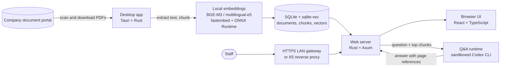

# Document Atlas · ISO Document Search and Review

An internal tool that makes a factory's ISO document library searchable and easier to clean up. It scans the company's document portal, indexes every PDF locally with a multilingual embedding model, and gives staff semantic search, question answering with page references, a PDF reader and a review workflow for duplicate or outdated documents. The delivered index covered about 1,900 documents (about 26,000 text chunks), all processed on the company's own server. It was handed over to the factory in November 2026.

> **No screenshots.** Document Atlas only runs against the company's internal documents, so this repository contains the source code and no data, index or document content.

## How it works



1. **Collect.** The desktop app (for the data steward) scans the portal, downloads new or changed PDFs and keeps the portal login in the operating system's credential store.
2. **Index.** Text is extracted from each PDF, split into chunks and embedded on the machine with no cloud API. Vectors live next to the documents in SQLite through the `sqlite-vec` extension.
3. **Search and answer.** The web server runs vector search, then the Q&A runtime answers in Thai from the retrieved chunks and links each answer to the source pages.
4. **Review.** Every document is compared with every other one using its chunk vectors. Boilerplate that appears on every page, such as the document-control notice, is ignored, so near-duplicates show up. Reviewers approve or reject the proposed status (`ACTIVE`, `ARCHIVE`, `DUPLICATE`, `REVIEW`) per department and export the result as CSV. Nothing is ever changed or deleted on the portal.

## Repository layout

```text
source/                Web edition
  server/src/          Rust (Axum) server: web.rs routes and auth, rag.rs indexing and search,
                       similar.rs duplicate detection, iso.rs review workflow, chat.rs Q&A
  src/                 React + TypeScript UI: search, RAG inspector, PDF reader, review, chat
desktop/source/        Tauri desktop app for scanning the portal and building the index
qa-runtime/            Node bridge that runs the Q&A model in a read-only, isolated session
lan-gateway.mjs        HTTPS gateway for the company LAN (PFX certificate, loopback upstream)
iis/web.config         Alternative: IIS reverse proxy configuration
*.ps1                  Windows scripts: start the server, create accounts, install the Q&A runtime
```

## Engineering notes

- **Rust backend.** Axum and Tokio, `rusqlite` with `sqlite-vec` for vector search, `fastembed` for local ONNX embeddings, and `pdf-extract`/`lopdf` for text. The server module has 37 unit tests (`cargo test`).
- **Runs on-premises.** Embedding runs on the server's CPU. The Q&A bridge strips API keys from its environment, disables shell tools, plugins and web search, and runs in a read-only, ephemeral sandbox.
- **Access control.** Per-person accounts with viewer and reviewer roles and randomly generated passwords. The app listens on loopback only, and staff reach it through the HTTPS gateway or IIS. `/healthz` is the only route that doesn't need a login.
- **PDF reader.** The server renders the requested page to an image, so the browser never downloads the whole document.
- **Grounded answers.** The Q&A prompt answers only from the retrieved passages, cites them by number, treats document text as untrusted data, and returns `insufficientEvidence` instead of guessing when the passages don't support an answer.
- **Desktop to web.** The web server's modules for indexing, search, duplicates and review were adapted from the desktop app's Rust code for a multi-user server.

## Build

The web edition needs Node.js 24 and Rust (MSVC toolchain on Windows).

```powershell
cd source
npm ci
npm run build
cargo build --release --manifest-path server/Cargo.toml
```

The desktop installer is built from `desktop/source` with `npm run build:windows` (Tauri, NSIS). Setup, HTTPS and operating instructions for IT are in [README-IT_TH.md](README-IT_TH.md) (Thai).
